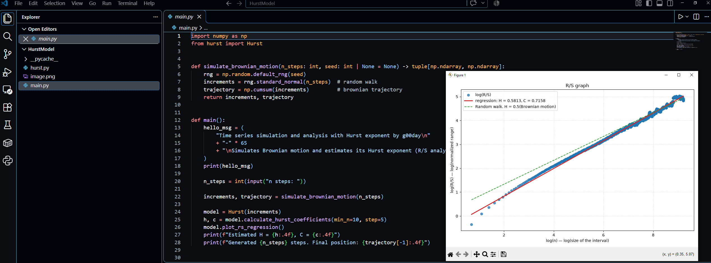
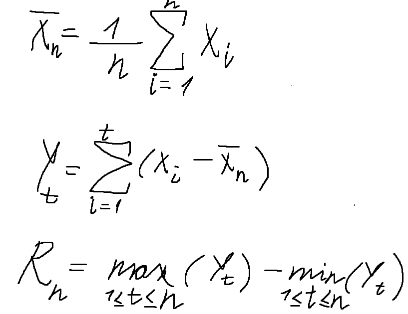
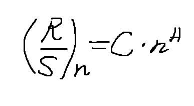

# Hurst model estimation

Easy implementation of Hurst model for estimating the time series memory and following to some trend - μ.



### How to run estimation

```
python main.py
```

### The implmenetation provides

* simulating random walk in the entry point.
* calculating normalized ranges (R/S)
* approximating the n -> R/S dependence as a linear regression(approximating __H__ and __C__)
* plotting the Hurst estimation compared to _H=0.5_(limit value for a brownian motion)

### Ranges and normalized range



